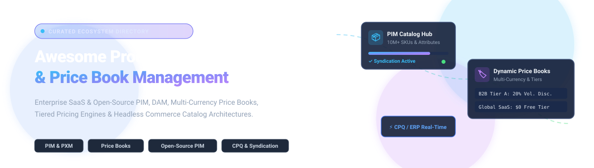

# Awesome Product Catalog & Price Book Management

  

  
  
  
  

> **A definitive, SEO-optimized curated directory of enterprise SaaS solutions and open-source software for Product Information Management (PIM), Product Experience Management (PXM), Price Books, Tiered Pricing Engines, and Headless Product Catalog Management.**

---

## Table of Contents

- [Overview & Architecture](#overview--architecture)
- [Sector Overview & Market Dynamics](#sector-overview--market-dynamics)
- [SaaS & Hosted Platforms](#saas--hosted-platforms)
- [Open-Source GitHub Projects](#open-source-github-projects)
  - [Full-Scale PIM Platforms](#full-scale-pim-platforms)
  - [Headless Commerce & Multi-Price Engines](#headless-commerce--multi-price-engines)
  - [Specialized Catalogs & Extensions](#specialized-catalogs--extensions)
- [Feature Comparison Matrix](#feature-comparison-matrix)
- [How to Contribute](#how-to-contribute)
- [License & Disclaimer](#license--disclaimer)

---

## Overview & Architecture

Modern omnichannel commerce requires synchronizing hundreds of thousands—sometimes millions—of stock-keeping units (SKUs) across varied digital sales channels, marketplaces (Amazon, eBay, Walmart), localized storefronts, and direct B2B sales pipelines. 

**Product Catalog & Price Book Management** systems centralize:
- **Core Product Attributes:** SKU taxonomies, technical specifications, variants (color/size/material), and localized copy.
- **Digital Asset Management (DAM):** High-resolution photography, 3D assets, specification PDFs, and compliance certifications.
- **Price Books & Pricing Logic:** Country-specific currencies, customer group tiers, volume discount schedules, promotional pricelists, and contractual CPQ (Configure, Price, Quote) agreements.
- **Syndication & Distribution:** Automated REST/GraphQL feeds mapped to merchant centers, POS terminals, and ERP backbones (SAP, NetSuite).

---

## Sector Overview & Market Dynamics

The global Product Information Management (PIM) and product catalog market is currently valued at approximately **$15 Billion to $18 Billion** and is projected to surpass **$37 Billion to $45 Billion by the 2030s**, compounding at a rapid **CAGR of ~14% to 16%**. 

The sector is **moderately fragmented**: mega-cap enterprise incumbents (Salesforce, SAP, HubSpot, IBM) dominate consolidated CRM/CPQ price-book workflows and generalized enterprise operations, while high-velocity specialized PIM/PXM leaders (Salsify, Akeneo, inriver) and disruptive open-core platforms (UnoPim, Pimcore, Medusa) capture dedicated mid-market and headless commerce workloads due to vertical-specific taxonomy requirements and modern API-first syndication demands.

---

## SaaS & Hosted Platforms

Below is a detailed breakdown of leading SaaS platforms offering dedicated product catalog, PIM, or price book capabilities. The table is sorted in descending order by **Company Size (Revenue / Market Capitalization)**.

| Platform | Company Size (Rev / Valuation) | Pricing (Starting Tier) | Free Tier / Trial Limits | Key Focus & Capabilities |
| :--- | :--- | :--- | :--- | :--- |
| **[Salesforce Price Books](https://www.salesforce.com/)** | **~$38B ARR** / ~$280B Market Cap | **$25/user/month** (Starter Suite; Pro Suite at $100/mo, Enterprise CRM at $165/mo) | **30-Day Free Trial** with full standard CRM & Price Book functionality; no permanent free tier | Native multi-currency price book hierarchy, volume discount tiers, and CPQ quote generation. |
| **[HubSpot Product Library](https://www.hubspot.com/)** | **~$2.5B ARR** / ~$30B Market Cap | **$15/seat/month** (Sales Hub Starter; Professional at $90/seat/month) | **Free Forever Plan** (capped at **100 products**, 100k deal associations; flat-rate pricing only) | CRM-native product catalog supporting SKUs, line-item quoting, deal tracking, and payment links. |
| **[Salsify](https://www.salsify.com/)** | **~$110M+ ARR** / **$2.0B Valuation** | **$1,500/month** (~$18,000/year base package) | **No Free Tier / No Self-Serve Trial**; private enterprise sandbox provided upon guided demo request | Product Experience Management (PXM), digital shelf analytics, GDSN compliance, and retailer syndication. |
| **[Akeneo PIM](https://www.akeneo.com/)** | **~$50M - $60M ARR** (Growth PE) | **$45,000/year** (~$3,750/month for Growth Edition) | **14-Day Guided Sandbox Trial** via sales demo; Community Edition open-source paused | Benchmark enterprise PIM with family attributes, Data Quality Insights, DAM, and Ziggy AI automation. |
| **[inriver](https://www.inriver.com/)** | **~$30M - $35M ARR** (PE Backed) | **$1,000/month** ($12,000/year Foundation package) | **No Free Tier / No Self-Serve Trial**; custom proof-of-concept trial via enterprise sales demo | Multi-tenant PIM with elastic data model, channel syndication, and digital catalog governance. |
| **[DealHub Catalog](https://dealhub.io/)** | **~$20M - $30M ARR** (Venture Backed) | **$10,000/year** (~$833/month base team tier) | **No Free Tier / No Self-Serve Trial**; sandbox evaluation available during guided CPQ demo | CPQ catalog management, subscription billing rules, contract lifecycle management, and deal rooms. |
| **[Katana Cloud](https://katanamrp.com/)** | **~$15M - $25M ARR** (Series B) | **$179/month** (Standard plan billed annually) | **15-Day Free Trial** (unlimited SKUs); degrades to permanent **Free Plan capped at 30 SKUs** & 3 locations | Cloud inventory, BOM manufacturing, multi-location catalog tracking, and B2B order routing. |
| **[Bluestone PIM](https://www.bluestonepim.com/)** | **~$15M - $20M ARR** (Growth Stage) | **$3,000/month** (MACH usage-based tier) | **30-Day Guided Sandbox Trial** upon request; no self-serve perpetual free tier | MACH-certified composable PIM built on graph database schemas for rapid headless API syndication. |
| **[Plytix](https://www.plytix.com/)** | **~$10M - $15M ARR** (Series A) | **$450/month** (Custom plan; Starter formerly $149/mo) | **Free Forever Plan** (capped at **500 SKUs**, unlimited user seats, 500 AI credits/month, 25GB DAM storage) | SMB-friendly PIM with integrated DAM, live product sheets, channel feeds, and automated PDF catalogs. |
| **[Pimcore](https://pimcore.com/)** | **~$10M - $15M ARR** (Growth Stage) | **$9,900/year** (~$825/month for Commercial Professional) | **Free Forever Plan** (restricted to non-production, non-profit, or organizations < **$5M annual revenue**) | Unified open-core data platform bundling PIM, MDM, DAM, and digital experience management (DXP). |

---

## Open-Source GitHub Projects

Open-source product catalog and price book software empowers teams to avoid vendor lock-in, customize complex relational schemas, and deploy on-premise or within self-hosted clouds (AWS, GCP, Azure, Bare-Metal Kubernetes).

The projects below are organized and sorted in descending order by **GitHub Star Count**.

### Full-Scale PIM Platforms

* **[Odoo](https://github.com/odoo/odoo)**   
  *Python / JavaScript • LGPLv3*  
  Comprehensive open-source business suite featuring a robust **Product Catalog & Pricelist Engine**. Supports rule-based dynamic pricing (seasonal discounts, margin-based markups, customer-specific price books), multi-currency conversions, SKU variants, and barcode management seamlessly connected to inventory, POS, and eCommerce modules.

* **[UnoPim](https://github.com/unopim/unopim)**   
  *PHP (Laravel) / Vue.js • Open-Source*  
  Modern, fast, and actively maintained open-source PIM engineered to handle **10 million+ product records**. Features include flexible attribute families, multi-channel syndication (Shopify, Bagisto, Amazon), multi-currency pricing, Magic AI content generation, DAM file attachments, localized translations in 33+ languages, and complete REST API coverage.

* **[Pimcore](https://github.com/pimcore/pimcore)**   
  *PHP (Symfony) / ExtJS • Pimcore Open Core License*  
  Enterprise-grade open-core platform delivering an integrated suite for PIM, Master Data Management (MDM), Digital Asset Management (DAM), and Customer Data Platforms (CDP). Offers granular class modeling, complex product relationships, 200+ media format previews, and GraphQL/REST Data Hub connectors. *(Note: Free community licensing is restricted to non-production, non-profit, or businesses under $5M/year revenue).*

* **[Akeneo PIM (Community Edition)](https://github.com/akeneo/pim-community-dev)**   
  *PHP (Symfony) • OSLv3*  
  The historic open-source benchmark for Product Information Management. Provides standardized product family modeling, attribute definitions, mass edits, and localization workflows. *(Note: Official upstream CE development was paused by Akeneo in 2023 with security support sunsetting September 2026).*

* **[AtroPIM](https://github.com/atrocore/atropim)**   
  *PHP / Backbone.js • GPLv3*  
  Flexible open-source PIM software built on the AtroCore framework. Empowers non-technical administrators to configure customized data models, entity relationships, classifications, and associations directly from the UI without backend code deployment.

### Headless Commerce & Multi-Price Engines

Many engineering teams leverage modern headless commerce backbones as their primary catalog and multi-currency price book service:

* **[Medusa](https://github.com/medusajs/medusa)**   
  *Node.js / TypeScript • MIT License*  
  Composable, headless commerce platform with dedicated modules for **Product Catalog** and **Pricing Engine**. Provides first-class support for multi-currency price lists, conditional customer group overrides, tiered bulk pricing, custom product attributes, and extensible workflows.

* **[Bagisto](https://github.com/bagisto/bagisto)**   
  *PHP (Laravel) / Vue.js • MIT License*  
  Complete open-source eCommerce ecosystem with robust product catalog management, configurable attributes, customer group pricing, localized channels, and native UnoPim connectivity.

* **[Saleor](https://github.com/saleor/saleor)**   
  *Python (Django) / GraphQL • BSD-3-Clause*  
  High-performance headless GraphQL commerce platform. Offers multichannel price books, complex product attribute configurations, tax rule mapping, and multi-warehouse catalog availability tracking.

* **[Spree Commerce](https://github.com/spree/spree)**   
  *Ruby on Rails • BSD-3-Clause*  
  Battle-tested headless commerce platform providing advanced multi-store catalog routing, localized currency price lists, variant taxonomy trees, and REST/GraphQL endpoints.

* **[Vendure](https://github.com/vendurehq/vendure)**   
  *Node.js / TypeScript • MIT License*  
  Modern TypeScript headless framework with customizable catalog schemas, facet/attribute engines, multi-channel pricing strategies, and automated digital asset transformations.

* **[Solidus](https://github.com/solidusio/solidus)**   
  *Ruby on Rails • BSD-3-Clause*  
  Enterprise-oriented open-source commerce engine featuring modular price book overrides, customer-segmented pricing tiers, and extensible catalog indexing.

### Specialized Catalogs & Extensions

* **[CoreShop](https://github.com/coreshop/CoreShop)**   
  *PHP (Symfony) • GPLv3*  
  E-commerce and catalog extension built natively on top of Pimcore. Adds native price lists, tiered quantity pricing, and quote-order pipelines directly to Pimcore's data model.

* **[catalogue-server](https://pypi.org/project/catalogue-server/)**  
  *Python (Django) • Open-Source*  
  Lightweight, modular Django application providing a country-aware product catalog, variant grouping, offer synchronization (WooCommerce, Shopify, Wix), and JSON REST endpoints.

* **[LibrePIM](https://github.com/librepim/librepim)**  
  *PHP (Symfony) • Open-Source Community Fork*  
  Community-led fork maintaining modern PHP 8.x compatibility, security fixes, and database driver updates for legacy Akeneo Community Edition deployments.

---

## Feature Comparison Matrix

| Capability | PIM Solutions (UnoPim, Akeneo, Plytix) | ERP / Catalog Suites (Odoo, Katana) | Headless Engines (Medusa, Saleor) | CRM / CPQ Engines (Salesforce, DealHub) |
| :--- | :--- | :--- | :--- | :--- |
| **Rich Attribute Modeling** | ★★★★★ (Native families & inheritances) | ★★★☆☆ (Standard variants & BOM) | ★★★★☆ (Facets & JSON schemas) | ★★★☆☆ (Fields & objects) |
| **Price Book Abstraction** | ★★☆☆☆ (Attribute-based pricing) | ★★★★☆ (Customer & currency pricelists) | ★★★★☆ (First-class price list module) | ★★★★★ (Dedicated multi-currency price books) |
| **Digital Asset Management**| ★★★★★ (High-res media, tags, CDN) | ★★☆☆☆ (Basic attachments) | ★★★☆☆ (File storage adapters) | ★★☆☆☆ (Document repository) |
| **Channel Syndication** | ★★★★★ (Amazon, Google Shopping feeds) | ★★☆☆☆ (Direct marketplace sync) | ★★★☆☆ (Headless webhooks/APIs) | ★★☆☆☆ (Internal sales quoting) |
| **Self-Hosting Capability** | ★★★★☆ (UnoPim, Pimcore, AtroPIM) | ★★★★☆ (Odoo Community) | ★★★★★ (100% open TypeScript/Python) | ☆☆☆☆☆ (Closed Cloud SaaS) |

---

## How to Contribute

Contributions from data architects, ecommerce engineers, and PIM practitioners are warmly welcomed!

1. **Fork** the repository.
2. **Create a branch** (`git checkout -b feature/add-new-tool`).
3. **Add your entry** under the appropriate SaaS or Open-Source category:
   - Ensure SaaS additions include verified starting tier pricing, free tier/trial limits, and approximate revenue/valuation.
   - Ensure open-source additions include valid GitHub links, short tech stack overview, and shields.io star badge (`style=social&color=white`).
4. **Test formatting** to guarantee tables and markdown links render cleanly.
5. **Submit a Pull Request** with a descriptive summary of changes.

---

## License & Disclaimer

- Distributed under the [MIT License](file:///C:/Users/hp/Documents/Projects/Awesome-Product-Catalog-Price-Book-Management/LICENSE).
- *Disclaimer:* All product names, logos, and brands are property of their respective owners. Company valuations and software pricing reflect published public documentation, procurement benchmarks, and investor disclosures as of late 2026. Self-hosted deployments require ongoing adherence to individual open-source licenses and institutional data protection regulations.
